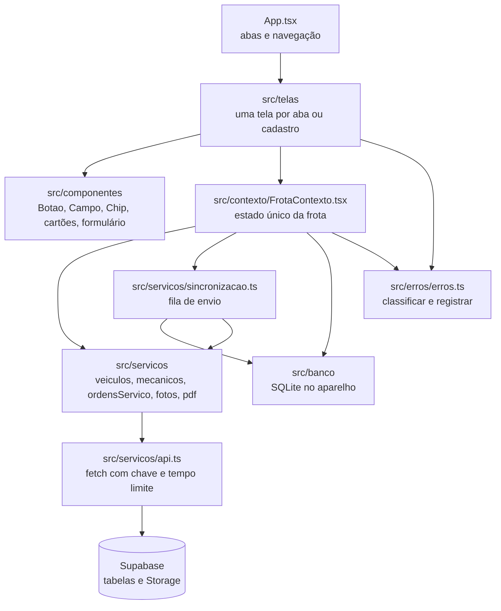
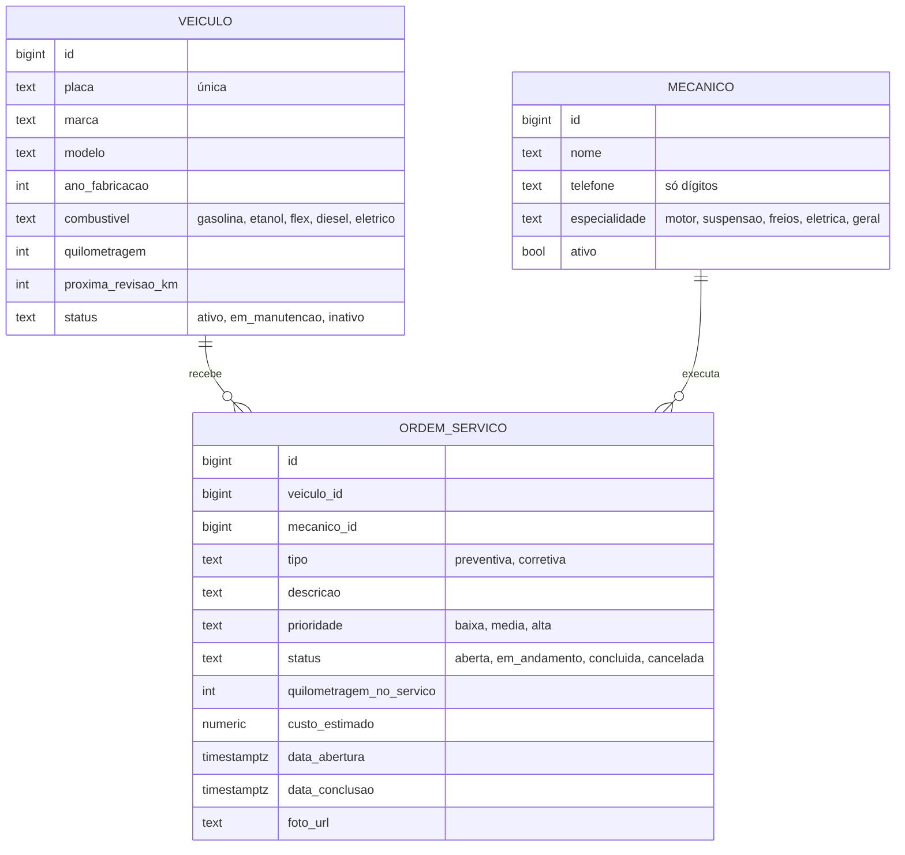
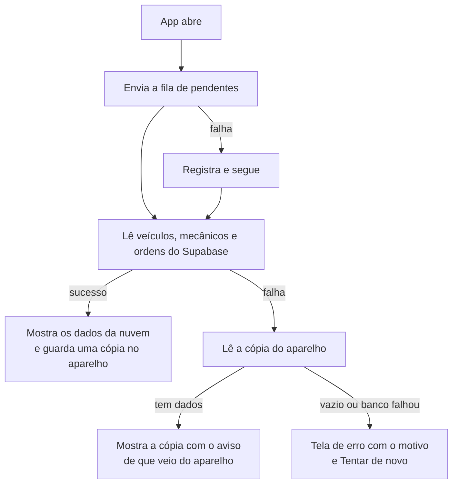

# Documentação do projeto: Gestão de manutenção de veículos

Aplicativo móvel da UC8, desenvolvido por Pablo Alejandro. Recorte do sistema **Gestão e manutenção preventiva e corretiva de veículos**, criado na UC5 para desktop.

| | |
|---|---|
| Versão | 1.0.0 |
| Plataformas | Android e iOS (Expo Go ou build nativo); web para conferência, sem banco no aparelho |
| Repositório | `pontespablobr-byte/uc8-projeto-mobile` |
| Roteiro de teste | [roteiro_de_teste.md](roteiro_de_teste.md) |

## Sumário

1. [Objetivo e público](#1-objetivo-e-público)
2. [Funcionalidades](#2-funcionalidades)
3. [Tecnologias](#3-tecnologias)
4. [Arquitetura](#4-arquitetura)
5. [Modelo de dados](#5-modelo-de-dados)
6. [Fluxos principais](#6-fluxos-principais)
7. [Segurança e permissões](#7-segurança-e-permissões)
8. [Tratamento de erros](#8-tratamento-de-erros)
9. [Instalação e execução](#9-instalação-e-execução)
10. [Testes](#10-testes)
11. [Limitações conhecidas](#11-limitações-conhecidas)

---

## 1. Objetivo e público

O aplicativo atende o **mecânico e o gestor de frota em campo**. Pelo celular, eles cadastram veículos e mecânicos, abrem ordens de serviço (OS) preventivas e corretivas com foto, acompanham e alteram o status de cada uma, geram o PDF das concluídas e consultam o valor dos serviços realizados.

Os dados ficam no **Supabase**, na nuvem. Uma cópia fica no aparelho, para o app funcionar sem rede, e a OS aberta sem rede é enviada quando a conexão volta.

Do sistema da UC5 ficaram de fora: cadastro de clientes, estoque e compra de peças, faturamento e nota fiscal, agendamento, gestão de perfis e permissões e notificações push.

## 2. Funcionalidades

A navegação é feita por uma barra de abas na parte de baixo da tela, com ícone e nome. Em telas a partir de 600 de largura (tablet ou celular deitado), as listas de veículos e de ordens passam a ter duas colunas. Nos cadastros, o erro de cada campo aparece embaixo dele, com a borda em vermelho.

| Aba | O que faz |
|---|---|
| **Veículos** | Lista todos os veículos com placa, quilometragem e próxima revisão. Busca por placa ou modelo. Mostra a quantidade de veículos por marca; tocar numa marca filtra a lista. Botões **+ Novo veículo** e **+ Novo mecânico**. |
| **Ordens** | Lista as OS, da mais recente para a mais antiga, com filtro por status (Todas, Aberta, Em andamento, Concluída, Cancelada). No filtro **Concluída**, cada OS tem **Gerar PDF**. Nos filtros **Aberta** e **Cancelada**, cada OS tem **Excluir**, com confirmação. |
| **Detalhe da OS** | Abre ao tocar numa OS. Mostra veículo, mecânico, serviço, datas e foto. Permite **editar**, **mudar o status**, **gerar o PDF** (só concluída) e **excluir** (só aberta ou cancelada). |
| **Nova OS** | Formulário com veículo, mecânico, tipo, prioridade, descrição, custo estimado e foto opcional, pela câmera ou pela galeria. A quilometragem do serviço é a do veículo naquele momento. |
| **Relatórios** | Valor geral dos serviços concluídos, quantidade, média, subtotal por tipo (preventiva e corretiva) e a lista de cada serviço com seu valor. |
| **Sobre** | Quantidade de veículos, mecânicos e ordens, o que o app faz, as tecnologias usadas, os dados guardados no aparelho e a versão. |

**Regras de negócio**

- A placa é aceita no modelo antigo (`ABC-1234`) ou Mercosul (`ABC1D23`) e não pode se repetir.
- O ano de fabricação vai de 1950 até o ano seguinte ao atual; a próxima revisão precisa ser maior que a quilometragem atual.
- O telefone do mecânico precisa ter DDD; é guardado só com dígitos e exibido com máscara.
- O custo aceita `350`, `350,50`, `350.50`, `1.234` e `1.234,50`, até R$ 99.999.999,99.
- Ao concluir uma OS, a data de conclusão é preenchida; ao mudar para outro status, ela é apagada.
- Só OS **abertas** ou **canceladas** podem ser excluídas. O PDF só é gerado para OS **concluídas**.
- O valor dos relatórios é o **custo estimado** de cada OS concluída.

## 3. Tecnologias

| Tecnologia | Versão | Uso |
|---|---|---|
| Expo SDK | 58 | Base do aplicativo e acesso aos recursos do aparelho |
| React Native | 0.88.1 | Interface |
| React | 19.3.0 | Componentes e estado |
| TypeScript | 6.0 (modo `strict`) | Tipagem de todo o código, sem `any` |
| Supabase | API REST (PostgREST) e Storage | Banco de dados e fotos na nuvem, acessados com `fetch` |
| expo-sqlite | 58 | Cópia dos dados no aparelho e fila de envio |
| expo-image-picker | 58 | Foto pela câmera ou pela galeria |
| expo-print e expo-sharing | 58 | Geração e compartilhamento do PDF |
| react-native-svg | 15.16 | Logo, faixa de risco e ícones das abas |
| react-native-safe-area-context | 5.11 | Respeito à área do relógio e da barra de gestos |

O acesso ao Supabase é feito com `fetch`, sem a biblioteca `supabase-js`: cada resposta chega como `unknown` e passa por uma verificação de tipo (type guard) antes de ser usada.

## 4. Arquitetura

O código está em `src/`, dividido em camadas. As telas não falam com a API nem com o banco diretamente: elas leem o estado e chamam ações do **contexto**, e o contexto usa os **serviços** e o **banco**.



| Pasta | Conteúdo |
|---|---|
| `src/telas` | `TelaVeiculos`, `TelaNovoVeiculo`, `TelaNovoMecanico`, `TelaOrdens`, `TelaDetalheOrdem`, `TelaEditarOrdem`, `TelaNovaOrdem`, `TelaRelatorios`, `TelaSobre` |
| `src/componentes` | Peças visuais reaproveitadas: `BarraAbas`, `Cabecalho`, `Logo`, `Botao`, `Campo`, `Chip`, `BadgeStatus`, `CartaoVeiculo`, `CartaoOrdemServico`, `FormularioOrdemServico`, `ConfirmarExclusao`, `AvisoEstadoFrota` |
| `src/contexto` | `FrotaContexto`: carrega os dados, guarda o estado e expõe as ações (incluir, editar, mudar status, excluir) com validação |
| `src/servicos` | Acesso ao Supabase por entidade, envio de fotos, geração do PDF e sincronização da fila |
| `src/banco` | SQLite no aparelho (`banco.ts`); no navegador, `banco.web.ts` recusa as operações |
| `src/erros` | Classificação e registro de erros |
| `src/types` | Tipos das entidades (`Veiculo`, `Mecanico`, `OrdemServico`) |
| `src/utils` | Formatação (moeda, data, placa, telefone, quilometragem), rótulos e o HTML do PDF |
| `src/tema` | Cores, espaçamentos e raio, num só lugar |
| `supabase` | Scripts SQL das tabelas e permissões |
| `docs` | Esta documentação e o roteiro de teste |

**Estado da tela.** O contexto guarda o estado como uma união discriminada, e cada tela desenha um caso:

| `tipo` | Tela mostra |
|---|---|
| `carregando` | Indicador de carregamento |
| `erro` | Mensagem e botão **Tentar de novo** |
| `pronto` com `origem: 'nuvem'` | Os dados do Supabase |
| `pronto` com `origem: 'aparelho'` | A cópia do aparelho e o aviso "Mostrando ... guardados no aparelho" |

## 5. Modelo de dados

### Entidades



No aplicativo, os campos usam `camelCase` (`veiculoId`, `custoEstimado`); no banco, `snake_case` (`veiculo_id`, `custo_estimado`). Cada serviço converte de um para o outro. Os ids são `string` no app e `bigint` no banco, e as datas são texto ISO 8601.

### No Supabase

| Tabela ou pasta | Criada por |
|---|---|
| `ordens_servico` | `supabase/esquema.sql` |
| `veiculos` e `mecanicos` | `supabase/esquema_frota.sql` |
| coluna `foto_url` e pasta `fotos-os` no Storage (até 5 MB, só imagens) | `supabase/edicao_e_fotos.sql` |

### No aparelho (SQLite, arquivo `frota.db`)

| Tabela | Conteúdo |
|---|---|
| `veiculos`, `mecanicos`, `ordens` | Cópia da última carga com rede, trocada inteira a cada carga, numa transação |
| `pendentes` | OS abertas sem rede, com a foto em base64, à espera de envio |

## 6. Fluxos principais

### Abertura do app



### Nova OS

1. A tela valida os campos, e o contexto valida de novo antes de enviar.
2. Se houver foto, ela vai primeiro para o Storage, e a OS guarda o endereço público.
3. A OS é enviada ao Supabase, que define o id, o status `aberta` e a data de abertura.
4. **Se o Supabase recusar** (dados inválidos, chave errada), a mensagem aparece no formulário e o que foi digitado continua lá.
5. **Se faltar rede**, a OS e a foto vão para a fila do aparelho, e a aba Ordens mostra "A enviar (N): ...".

### Sincronização da fila

Na abertura seguinte com rede, cada pendente é enviado, do mais antigo para o mais novo: primeiro a foto, depois a OS. Se faltar rede de novo, o envio para, e o restante fica para a próxima vez. Se o Supabase recusar os dados da OS (códigos 400, 409 ou 422), ela é descartada e o descarte fica registrado. Uma chave recusada (401) não descarta nada.

### Edição, status e exclusão

A edição envia ao Supabase os campos do formulário; a troca de status envia só o status e a data de conclusão. Nos dois casos, a tela passa a mostrar a versão que o banco devolveu. A exclusão pede confirmação na própria tela e só é oferecida para OS abertas ou canceladas; o banco aplica a mesma regra.

### PDF

O app monta um documento HTML com a OS, o veículo, o mecânico, os valores, a foto e espaço para assinaturas, sempre em papel branco, mesmo com o aparelho no modo escuro. No celular, o `expo-print` gera o PDF em tamanho A4 e o `expo-sharing` abre o menu de compartilhar (WhatsApp, e-mail, arquivos). No navegador, abre a impressão do documento.

## 7. Segurança e permissões

- O app usa a **chave publicável** do Supabase, feita para ficar no aplicativo. A URL e a chave ficam no `.env.local`, que não vai para o repositório. A senha do banco e a chave secreta nunca entram no app.
- Todas as tabelas têm **RLS** (segurança por linha) ligada. O que o app pode fazer com a chave publicável:

| Tabela | Ler | Incluir | Alterar | Excluir |
|---|---|---|---|---|
| `veiculos` | sim | sim | não (`revoke`) | não (`revoke`) |
| `mecanicos` | sim | sim | não (`revoke`) | não (`revoke`) |
| `ordens_servico` | sim | sim | sim (edição e status) | só abertas ou canceladas |
| Storage `fotos-os` | sim (pasta pública) | sim (até 5 MB, só imagens) | não | não |

- `supabase/endurecimento.sql` retira de veículos e mecânicos o privilégio de alterar e apagar, e a API passa a recusar com o código **42501**. Nas ordens, alterar e excluir continuam permitidos porque são funções do app, limitados pelas políticas de `edicao_e_fotos.sql` e `exclusao.sql`.
- Todo texto digitado é escapado antes de entrar no HTML do PDF.
- **Dados pessoais (LGPD):** o projeto usa apenas dados fictícios. As fotos ficam numa pasta pública, então não se deve fotografar pessoas nem documentos.

## 8. Tratamento de erros

Todos os erros passam por `src/erros/erros.ts`:

- `classificarErro` decide o tipo e a mensagem que a pessoa vê.
- `registrarErro(origem, erro)` escreve no console a origem e o detalhe técnico, e devolve a mensagem para a tela.

| Tipo | Quando | Mensagem na tela |
|---|---|---|
| `rede` | Sem conexão, ou o servidor não respondeu em 15 s (60 s para a foto) | "Sem conexão com o servidor. Verifique a rede e tente de novo." |
| `api` | O Supabase recusou | Uma por código: 400 mostra o motivo; 401 manda conferir o `.env.local`; 403 explica a regra do app; 404 manda conferir os SQL; 42501 diz que a operação não é permitida |
| `banco` | Falha no SQLite do aparelho (`ErroDoBanco`) | "Não foi possível ler ou guardar os dados no aparelho." |
| `validacao` | Dado inválido (`ErroDeValidacao`) | A regra que não foi cumprida |
| `desconhecido` | Qualquer outro | O texto do erro |

Falta de rede e dado inválido são esperados e vão para `console.log`; os demais vão para `console.error`. A falha do banco do aparelho nunca derruba a lista que veio da nuvem.

## 9. Instalação e execução

**Requisitos:** Node.js 22 ou mais novo, um projeto no Supabase e, para ver no celular, o app **Expo Go**.

1. Instale as dependências:
   ```bash
   npm install
   ```
2. Copie `.env.example` para `.env.local` e preencha com a URL e a chave publicável do projeto (a seção Configuração do [README](../README.md) traz os valores).
3. No **SQL Editor** do Supabase, execute uma vez cada arquivo, nesta ordem:
   1. `supabase/esquema.sql`
   2. `supabase/esquema_frota.sql`
   3. `supabase/edicao_e_fotos.sql`
   4. `supabase/exclusao.sql`
   5. `supabase/endurecimento.sql`
4. Suba o servidor e leia o QR Code com o Expo Go:
   ```bash
   npx expo start
   ```
5. Confira os tipos:
   ```bash
   npm run typecheck
   ```

Depois de mudar o `.env.local` ou instalar uma biblioteca, pare o servidor (Ctrl+C), suba de novo e recarregue o app.

## 10. Testes

O roteiro completo, com passos, resultado esperado, resultado observado e data, está em [roteiro_de_teste.md](roteiro_de_teste.md). Os casos foram executados em três ambientes:

| Ambiente | O que cobre |
|---|---|
| **Navegador** | O app exportado para web, dirigido por um teste automatizado no Edge, numa janela de celular: todas as telas e fluxos, validações, mensagens de erro e alinhamento em 412, 360 e 320 px. As leituras vão ao Supabase real; as gravações são simuladas. |
| **Node** | O código real do banco do aparelho, da fila e da classificação de erros, com o SQLite em memória; os scripts SQL num Postgres de teste; o PDF gerado e conferido. |
| **Aparelho** | iPhone com Expo Go: cadastro sem rede, sincronização e rede ruim. |

Resultado atual: **35 aprovados, 5 corrigidos, 1 falha e 4 não executados**. Os não executados dependem do aparelho (câmera, teclado no Android e abertura sem rede), e a falha é uma mensagem já corrigida que ainda não foi repetida no celular.

## 11. Limitações conhecidas

- **Navegador sem banco no aparelho:** o `expo-sqlite` para web ainda é experimental e exige configuração própria do servidor. No navegador, o app funciona só com a nuvem: não guarda cópia nem abre OS sem rede.
- **Só a OS entra na fila sem rede:** cadastrar veículo ou mecânico, editar, mudar status e excluir precisam de conexão.
- **Valor dos relatórios:** é o custo estimado. O app não tem campo de valor final cobrado.
- **Foto de OS excluída:** o arquivo continua no Storage, porque o app não tem permissão para apagar fotos. A remoção é feita pelo painel do Supabase.
- **Status do veículo:** a aba Veículos mostra todos como "Ativo", mesmo que o banco guarde outro status.
- **Detalhe do veículo:** tocar no cartão de um veículo não abre uma tela própria.
